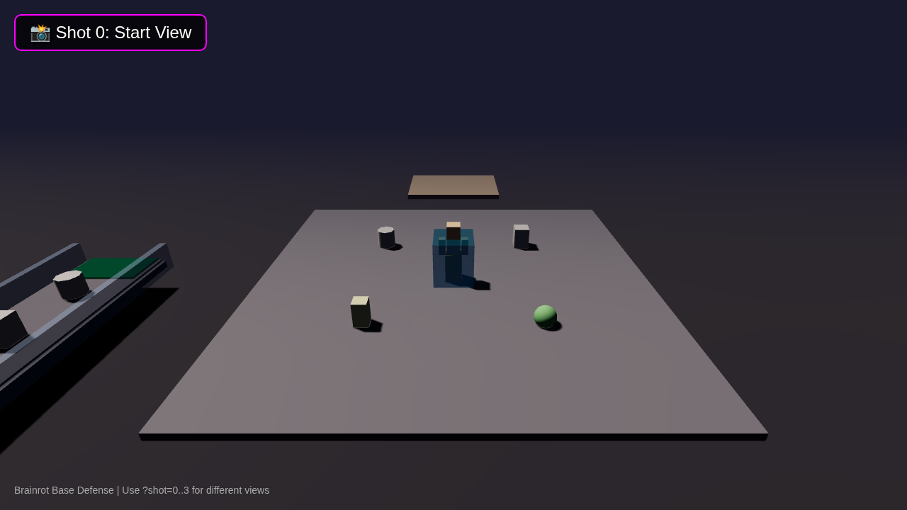
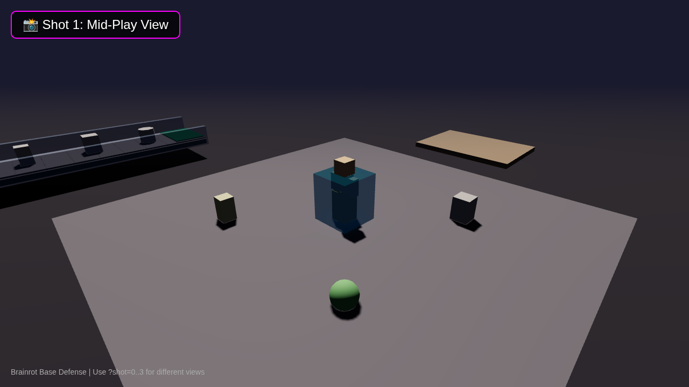
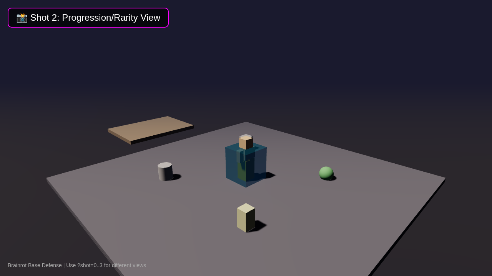
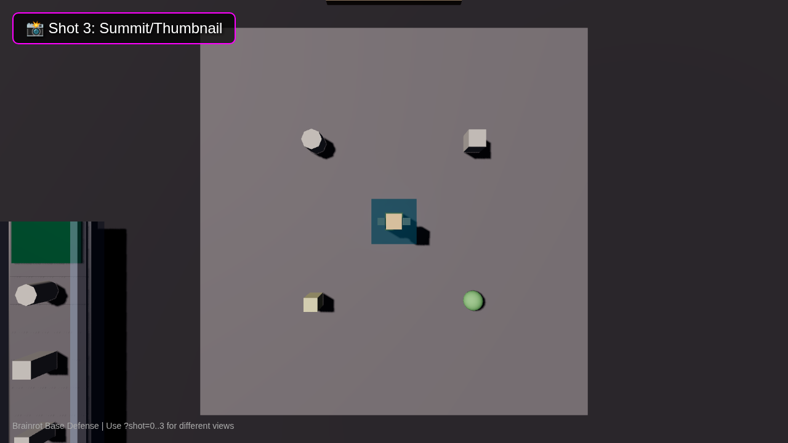

# Brainrot Base Defense

**Brainrot Base Defense** is a tower defense / base building Roblox game where you collect and place "brainrot" meme characters to defend your base core against waves of enemies. Earn money, upgrade your base, rebirth for permanent bonuses, and build the ultimate brainrot army!

## Gameplay

- **Collect Brainrots**: Buy brainrot characters from the shop — each has a unique money-per-second rate and rarity (Common → Mythic → Void)
- **Place Strategically**: Place brainrots on your 4×4 base grid to generate passive income
- **Defend the Core**: Waves of enemies spawn from the conveyor lane and march toward your base core — your placed brainrots attack automatically
- **Upgrade & Rebirth**: Spend money on upgrades (Base Defense, Money Multiplier, Spawn Rate, Base Size, Offline Time, Steal Power). Rebirth to reset with permanent bonuses and unlock rarer mutations!
- **Mutations**: Brainrots can have mutations (Shiny, Golden, Rainbow, Corrupted, Glitched, Void) that massively boost their earnings
- **Steal Mechanics**: Risk/reward — attempt to steal other players' brainrots for big payouts

## Screenshots

| Start View | Mid-Play View | Progression View | Summit View |
|------------|---------------|------------------|-------------|
|  |  |  |  |

## Badges


## Technical Details

- **Framework**: Rojo 7.7.1 project structure
- **Language**: Luau (Roblox TypeScript)
- **Architecture**: Client-server with ReplicatedStorage shared modules
- **Networking**: RemoteEvents/RemoteFunctions for client-server communication
- **Data Persistence**: DataStore with offline progress calculation

## Project Structure

```
src/
├── shared/           # Shared modules (both client & server)
│   ├── BrainrotData.luau    # Brainrot definitions, rarities, mutations
│   ├── GameConfig.luau      # Game balance & configuration
│   ├── PlayerData.luau      # Player data structure & validation
│   ├── Network.luau         # RemoteEvent/RemoteFunction definitions
│   └── Utility.luau         # Helper functions
├── server/           # ServerScriptService scripts
│   ├── init.server.luau     # Server initialization
│   ├── DataManager.server.luau   # DataStore handling
│   ├── GameLoop.server.luau      # Wave spawning, combat, economy
│   └── WorldManager.server.luau  # Base building, placement
└── client/           # StarterPlayerScripts
    ├── init.client.luau     # Client initialization
    ├── HUD.client.luau      # Heads-up display
    ├── UIComponents.client.luau  # Reusable UI components
    └── PlayerData.client.luau    # Client-side data cache
```

## Development

```bash
# Build the game.rbxl from source
rojo build -o game.rbxl

# Run the screenshot capture (requires Chrome)
cd tools && node capture-screenshots.mjs

# Package for submission
mkdir -p out && MAKEFUN_OUTPUT_DIR=out node main.ts
```

## Submission

This entry is submitted for the **make.fun "Make the best AI Roblox brainrot game" bounty (roblox-brainrot-01)**.